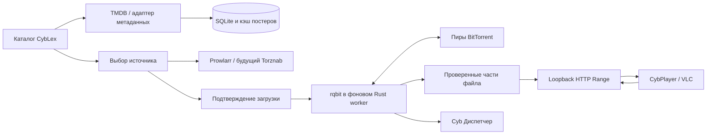
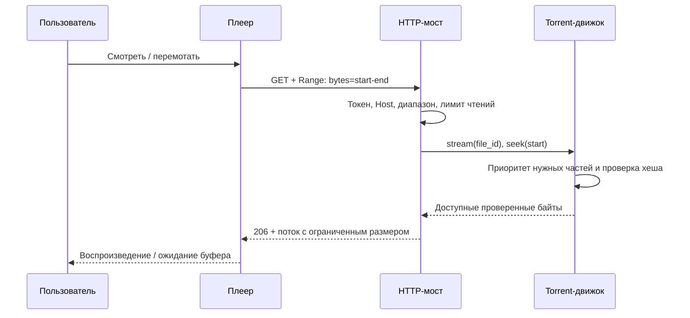

# CybLex: архитектура потокового P2P-просмотра

Редакция: 11 октября 2026 года. Документ относится к CybOS-demo и отделяет реализованный прототип от следующих этапов. Он описывает решения, последовательность операций и ограничения. По снимку Zona можно воспроизвести каталог с постерами, рейтингом, годом, жанрами, избранным и просмотром; определить её внутренний движок по изображению нельзя.

## 1. Продукт и основной сценарий

Пользователь открывает CybLex, выбирает фильм или сериал, смотрит описание, выбирает источник и явно запускает загрузку. После получения метаданных торрента он выбирает видеофайл и нажимает «Смотреть сейчас». Плеер начинает воспроизведение, когда получены необходимые части; остальной файл продолжает загружаться. Перемотка меняет приоритеты загрузки.

Каталог метаданных не содержит видео. TMDB предоставляет названия, описания, постеры, рейтинги и идентификаторы. Prowlarr ищет в индексаторах, которые пользователь подключил отдельно. Свои magnet-ссылки и .torrent можно добавить без каталога и индексатора. Приложение не должно показывать «просмотр доступен», если известна только карточка фильма.



## 2. Технологический стек

### Для существующего CybOS

Сохраняем Rust + eframe/egui для настольного интерфейса и Tokio для фоновых операций. В проекте уже используется librqbit 9.0.1. Поэтому не добавляем второй torrent-движок: его seekable FileStream позволяет ждать нужные части файла и приоритизировать чтение. HTTP-мост строится на Axum, а поток тела — на tokio-util ReaderStream. Данные приложения и каталог хранятся в SQLite. Это уменьшает число процессов и связей между ними. Возможности rqbit описаны в [официальном репозитории](https://github.com/ikatson/rqbit).

На macOS первый плеер — Swift/AppKit + AVKit/AVFoundation в отдельном окне CybPlayer. Он поставляется внутри пакета CybOS. На Windows/Linux прототип передаёт поток установленному VLC. Это текущая граница кроссплатформенности воспроизведения; универсальный встроенный плеер ещё предстоит создать.

### Варианты для новых клиентов

Electron + React подходит для команды, которая делает основной интерфейс на TypeScript: удобная сетка карточек и веб-компоненты, но больше памяти и отдельная граница IPC. Сам браузерный renderer не должен получать файловую систему, torrent-команды и секреты напрямую.

Flutter — вариант для единого мобильного интерфейса с нативными адаптерами плеера. React Native также возможен, если команда ориентирована на React. Общий Rust-движок можно вынести за стабильный FFI-интерфейс: add, list_files, play, pause, remove, subscribe_events. Android использует Media3/ExoPlayer, iOS — AVPlayer либо разрешённый нативный адаптер. Это отдельный этап разработки, а не текущая мобильная сборка.

Node.js + WebTorrent удобен для Electron, Go + anacrolix/torrent — для автономного локального сервиса, C++ libtorrent — для тонкого управления дедлайнами частей. Выбор языка сам по себе не решает совместимость кодеков. Браузерный WebTorrent с WebRTC и обычные TCP/uTP BitTorrent-сети также требуют совместимых пиров; нельзя считать их полностью взаимозаменяемыми. См. [WebTorrent](https://webtorrent.io/faq) и [anacrolix/torrent](https://github.com/anacrolix/torrent).

## 3. Каталог и кэш

Основной поставщик — TMDB. Токен API Read Access Token передаётся в заголовке Authorization: Bearer и вводится локально. В текущем прототипе он хранится только в памяти процесса, не попадает в Git и базу. Официальная схема: [TMDB Application Authentication](https://developer.themoviedb.org/docs/authentication-application).

Используем отдельные пространства ключей movie:{id} и tv:{id}: одинаковые числовые ID фильма и сериала не означают один объект. Начальные полки: movie/now_playing, movie/popular, tv/popular. Жанры получаем из genre/movie/list или genre/tv/list; изображения строим через фиксированный image.tmdb.org и проверенный poster_path. См. [списки новинок](https://developer.themoviedb.org/reference/movie-now-playing-list), [сериалы](https://developer.themoviedb.org/reference/tv-series-popular-list), [изображения](https://developer.themoviedb.org/docs/image-basics).

Реализованный кэш: SQLite kv, срок актуальности метаданных 6 часов, ручное обновление; при отсутствии сети остаётся сохранённая полка. Постеры сохраняются отдельно, максимум 120 файлов по 512 КиБ; новые записи заменяются через временный файл. Декодирование ограничено размерами и объёмом памяти. Избранное хранится локально.

Для расширения: пагинация, поиск по названию, trending/week, карточка деталей, сезоны и эпизоды, отдельный кэш жанров на неделю. TTL — политика CybOS, а не ограничение TMDB. У сетевых запросов нужны тайм-ауты, ограничение ответа, backoff, обработка 429 и сохранение старых данных при ошибке. В публичной сборке необходимо добавить утверждённый логотип TMDB и выполнить условия атрибуции; текст атрибуции уже присутствует. [TMDB FAQ](https://developer.themoviedb.org/docs/faq) и [условия API](https://www.themoviedb.org/api-terms-of-use).

КиноПоиск можно подключить через отдельный MetadataProvider. Неофициальный сторонний сервис с таким названием нельзя объявлять официальным API КиноПоиска. Провайдер должен иметь свою схему авторизации, контракт, лимиты и сопоставление внешних ID.

## 4. Поиск источников и защита от неправильного фильма

Встроенный HTML-парсер каждого трекера потребует постоянного обслуживания, разбора изменений страниц и правил доступа. Для первой реализации используется пользовательский Prowlarr на 127.0.0.1:9696. CybLex вызывает GET /api/v1/search с X-Api-Key и параметрами query, type, limit. POST в этом API не следует путать с поиском: он связан с выбором релиза. Точный контракт описан в [официальном OpenAPI Prowlarr](https://prowlarr.com/docs/api/).

Jackett — альтернативный адаптер Torznab. Перед поиском читаются t=caps и поддерживаемые параметры конкретного индексатора; затем movie/tvsearch и доступные ID. Не каждый индексатор поддерживает IMDb/TMDB. См. [Jackett README](https://github.com/Jackett/Jackett).

Нормализованный результат должен содержать название, внешний ID, размер, сиды, источник, качество, язык, кодеки, тип раздачи и magnet либо источник .torrent. Эти поля сообщает индексатор; совпадение ID не доказывает фактическое содержимое файлов.

Порядок сопоставления:

1. Получить IMDb ID через movie/{id}/external_ids или tv/{id}/external_ids. Сохранить связь с TMDB, а не искать по переведённому названию вслепую.
2. Отбросить результаты с конфликтующим IMDb ID. Для фильма также отбрасывать конфликтующий movie TMDB ID. Идентификаторы сериала требуют отдельной обработки: поле релиза с названием tmdbId нельзя автоматически считать ID сериала.
3. Если ID отсутствует, сопоставить нормализованное оригинальное/локальное название и год фильма. У сериала дополнительно проверять сезон, эпизод, полный сезон и диапазоны эпизодов.
4. Пометить совпадение только по названию как требующее ручной проверки. Не запускать его автоматически.
5. Убрать нежелательные CAM/TS, учесть выбранное 1080p/4K, сиды, размер, доступные кодеки и язык. Нулевые или неизвестные сиды не гарантируют доступность.

Текущий адаптер сортирует по уверенности сопоставления, выбранному качеству и числу сидов; выбор источника заполняет magnet, а загрузка требует отдельного подтверждения. Релизы без magnet добавляются вручную. Выбор сезонов/эпизодов, языков, оценка кодеков и автоматическое получение .torrent через proxy индексатора — следующие задачи. В реальном источнике это ещё не проверено: для этого нужны настроенный Prowlarr и личные ключи.

## 5. Последовательный P2P-стриминг

Строгое завершение кусочков «от 0 до 100%» — неверное требование к видеопросмотру. Запросы выполняются параллельно; MP4 может потребовать индекс moov в конце файла, а перемотка — диапазон далеко от начала. Правильное требование: приоритет необходимых для текущего чтения частей, проверка их хешей и непрерывный доступный буфер.

Для CybOS используется rqbit FileStream. Он реализует AsyncRead + AsyncSeek; при ожидании недостающих данных не подменяет их нулевыми байтами. После seek движок учитывает новую позицию чтения. Самостоятельно читать частично загруженный файл через std::fs::File нельзя: размер на диске не означает, что байты получены и проверены.

Ключевой узел текущей реализации:

```rust
use std::io::SeekFrom;
use tokio::io::{AsyncReadExt, AsyncSeekExt};

// handle — Arc<librqbit::ManagedTorrent>, file_id — индекс выбранного видео.
let mut file = handle.clone().stream(file_id).await?;
let file_length = file.len();
file.seek(SeekFrom::Start(range_start)).await?;
let body_reader = file.take(range_length);
let stream = tokio_util::io::ReaderStream::with_capacity(body_reader, 64 * 1024);
let body = axum::body::Body::from_stream(stream);
// Возвратить body с проверенными заголовками 200/206 и Content-Length.
```

При выборе libtorrent эквивалентная политика строится на sequential download и set_piece_deadline. Ближние к воспроизведению части получают меньший дедлайн; после перемотки старые дедлайны снимаются, окно обновляется. Приоритеты не гарантируют строгий порядок фактического получения. См. [официальный Torrent Handle API](https://www.libtorrent.org/reference-Torrent_Handle.html).

Для промышленного режима добавляются измерение секунд буфера по демультиплексору, оценка скорости и битрейта, начальный порог воспроизведения, предел дискового кэша, выбор только нужных видео/субтитров, ограничение upload/download, восстановление позиции и политика раздачи после просмотра. Эти функции должны опираться на реальные данные, а не общий процент торрента.

## 6. Локальный HTTP-мост

Сервер запускается внутри фонового Rust runtime. Он слушает только 127.0.0.1 на случайном свободном порту. URL содержит случайный токен для конкретного сеанса просмотра. Маршрут не принимает файловый путь и не открывает административный rqbit API.

Пример: http://127.0.0.1:<port>/watch/<session-token>. URL не публикуется в журнале. Проверяются токен и Host; запросы с Origin отклоняются. CORS не открывается. Ограничение — четыре активных чтения. Локальная операционная система и программы с правами пользователя всё равно входят в доверенную среду.

Поддерживаются GET и HEAD, обычный ответ 200, одиночный диапазон 206, открытый диапазон bytes=5000-, суффикс bytes=-1000 и ошибка 416 с Content-Range: bytes */length. Некорректные и множественные диапазоны отклоняются. Для выбранного диапазона выставляются точные Content-Length, Content-Range, Accept-Ranges и MIME. См. [HTTP Range, RFC 9110](https://www.rfc-editor.org/rfc/rfc9110.html#section-14).



Остановка отменяет общий cancellation token: listener закрывается, а активный body reader просыпается даже при ожидании недостающих частей и завершает чтение. При смене видео предыдущий URL также отзывается. Обычная загрузка торрента остаётся отдельной операцией.

## 7. Видеоплеер, звук и субтитры

CybPlayer на macOS получает только локальный URL. AVPlayerView даёт управление воспроизведением, перемоткой и полноэкранным режимом. Состояние AVPlayerItem наблюдается через KVO; ошибка не скрывается за бесконечным «загружается». [Документация Apple](https://developer.apple.com/documentation/AVFoundation/observing-playback-state-in-swiftui).

Контейнер MP4 не гарантирует поддержку всех кодеков. H.264 + AAC — разумный базовый профиль. AC3, DTS, конкретные варианты HEVC/AV1 и MKV требуют проверки. HTML5 Video ограничен системными/браузерными декодерами. В текущем прототипе MKV/WebM/AVI направляются установленному VLC, а из CybPlayer можно перейти в VLC при неподдерживаемом кодеке. Окно CybPlayer отдельное; видеоповерхность внутри egui ещё не встроена.

Следующий вариант для единого встроенного плеера — libmpv либо VLCKit с контролируемой сборкой библиотек. Перед распространением нужно проверить лицензии конкретных бинарников и подключённых кодеков. Если выбран HTML5-клиент, FFmpeg remux сохраняет поддерживаемое видео, а транскодирование AC3/DTS в AAC меняет аудио; это отдельный ограниченный worker с нагрузкой в диспетчере. Полное перекодирование 4K не должно запускаться автоматически без оценки ресурсов.

Субтитры пока не внедрены. План:

- Найти внутри торрента SRT/VTT/ASS, дать выбрать язык и нужный файл; приоритет его частей отделить от видео.
- Читать только файл из проверенного torrent manifest, ограничить размер, обработать UTF-8/BOM и кодировки явно. Текст субтитров не интерпретировать как HTML.
- Для HTML5 нормализовать в WebVTT и подключить track. Для mpv/VLC использовать внешний subtitle track; в AVPlayer отдельно решить muxed legible track либо синхронизированный текстовый overlay.
- OpenSubtitles: отдельный API-ключ, при необходимости логин, поиск по IMDb, сезону/эпизоду и доступному movie hash, затем явный download; соблюдать квоты и проверять временный URL. Нельзя вычислять hash, выдавая ещё не загруженные начало/конец файла за достоверные байты. Первичная документация: [OpenSubtitles API](https://opensubtitles.stoplight.io/docs/opensubtitles-api).

## 8. Cyb Диспетчер и навигация

В основной навигации убрана «Главная», начальная вкладка — выделенный граф знаний. «Cyb Диспетчер» собирает показатели приложения и подробную диагностику. Браузер и устройства освобождены от своих графиков; рабочие статусы, например ожидание загрузки и результат отправки, остаются рядом с действием.

Измеряемые сейчас величины: CPU процесса CybOS, его resident memory на macOS/Linux, число недавних LAN-устройств, активные торренты, размер текстового документа браузера, число узлов графа. Сэмплы собираются раз в секунду при работе интерфейса, независимо от выбранной вкладки. CPU 100% соответствует одному ядру. Процессы Qwen, CybBrowser, CybPlayer и VLC в этот показатель не входят. На неподдерживаемой системе недоступный показатель помечается явно. Это не монитор всего компьютера.

Следом: скорости загрузки/раздачи по torrent-сессии, peers/seeds от движка, состояние stream-сервера, секунды доступного буфера, процессы дочерних модулей и размер кэша. Имена и единицы измерения должны быть понятными, графики — показывать фактические значения.

## 9. CybChat

В интерфейсе добавлены левая панель, вкладки «Чаты», «Друзья», «Группы», поиск контактов, локальные имена, отдельная история собеседников и независимые черновики. Группа хранится локально с UUID, названием, создателем и составом до 16 участников. Первое сообщение создателя является приглашением; получатель явно присоединяется.

Сообщения группы идут по отдельным Noise-соединениям каждому участнику, с уже проверенными ключами. Пользователь видит результат по каждому адресу. Метаданные группы должны совпадать с принятой группой; сообщения посторонних не попадают в её ленту. Проверяются ID и членство, одинаковые логические сообщения не дублируются в отображении. Это начальный протокол для малых групп: нет серверной очереди, фоновой офлайн-доставки, изменения состава, глобального поиска друзей и доставки через интернет без доступных маршрутов. Все участники должны использовать совместимую сборку. ACK транспорта означает сохранение входящего сообщения, а не принятие приглашения и не прочтение.

## 10. Проверка и порядок дальнейшей разработки

Проведены тесты байтовых диапазонов, ответа из реального rqbit FileStream на созданном локальном файле, HEAD, чтения с конца, отказа неправильному токену/веб-Origin, правил групп, сохранения данных и отката неудачных операций. Это не проверка воспроизведения реального фильма во время получения от удалённых пиров. Доступен один Mac; проверка групп на нескольких физических устройствах ещё необходима. TMDB/Prowlarr без личных настроек не проверялись в реальном аккаунте.

Порядок следующего этапа:

1. Два локальных P2P-узла с собственным тестовым MP4: воспроизведение до завершения загрузки, перемотка, пауза, исчезновение пира, низкая скорость.
2. Лимиты буфера и диска, возобновление torrent-сессии по явному действию пользователя после перезапуска.
3. Выбор серий и языков, локальные субтитры, полноценные карточки деталей и поиск каталога.
4. Настроенные провайдеры: интеграционная проверка API, proxy .torrent, лимиты и backoff, проверка доступности источника.
5. Единый встроенный codec-capable плеер, тестирование Windows/Linux, затем мобильный клиент.
6. Группы CybChat на нескольких устройствах: частичная доставка, повторное отправление без дублей, офлайн-очередь, версия состава, приглашение/выход и обновление ключей.

Публичный релиз возможен после прохождения этих проверок, добавления требуемой атрибуции поставщиков и сборки с подписью. Текущая работа — проверяемый прототип и основа для дальнейшей реализации.
