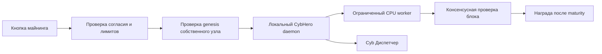

# CybHero: майнинг, распределение и постквантовая защита

Статус на 11 октября 2026: проект протокола и проверяемая основа разработки. Сеть CYBH не запущена. Этот документ не означает выпуск монеты, доходность майнинга или доказанную анонимность.

## 1. Что именно создаём

CybHero — нативная монета собственной сети, а не токен Solana и не переименованный баланс Monero. ROBOTCYB и CICADAFARM остаются отдельными активами. Начальный кандидат — фиксированная версия [Monero](https://github.com/monero-project/monero), указанная в `config/upstream.json`. `tools/prepare_monero.py` получает исходник, сохраняет лицензии и проверяет ревизию; он не запускает узел.

До запуска необходимо выбрать уникальные network UUID, genesis transaction и nonce, адресные префиксы, P2P/RPC порты, seeds, расписание hard fork и эмиссии. Нужно заменить исходные параметры сети и тестовые векторы согласованным патчем. Простая замена названий не отделяет сеть от Monero. Неизменённый исходник нельзя запускать под видом CybHero.

Предложение: нулевой premine, публичная спецификация и дата старта, одинаковые правила для всех участников, отдельная тестовая сеть с обнуляемыми монетами. Общая эмиссия, tail emission, целевой интервал блока и размер вознаграждения пока не утверждены. Не подставлять экономические константы без анализа бюджета безопасности и тестов сложности.

## 2. Как распределять монеты за реальную работу

Консенсус принимает блок только после проверки proof of work, сложности, предыдущего блока, транзакций, отсутствия double spend и допустимого coinbase reward. Нельзя начислять деньги за наличие приложения, время работы, число компьютеров, заявленный hashrate или владение токеном. Эти показатели подделываются и создают Sybil-атаку.

Награда возникает за принятый блок. Solo-майнер получает её с вероятностью, связанной с долей выполненной работы; обещания стабильного дохода нет. Пул сглаживает дисперсию и учитывает только проверенные shares. Проверка share требует актуального job ID, seed, nonce, вычисленного RandomX-хеша, соблюдения share target и защиты от повторов. Работа на устаревшей ветке не равна принятому сетевому блоку.

Оценка ожидаемой работы share пропорциональна `2^256 / (target + 1)`. Использовать целые числа достаточной разрядности, а не float для выплат. В пуле с разной сложностью считать вес работы, а не простое число shares. PPLNS считать в окне накопленной работы; порядок, комиссии, округление, остатки и минимальную выплату определить заранее. Вознаграждение подтверждать после coinbase maturity, обрабатывать reorg и сверять журнал выплат с собственным узлом. Клиентский счётчик не является доказательством награды.

Предпочтение — возможность solo-майнинга и независимых пулов. Один обязательный пул создаёт цензуру и централизацию. Децентрализованный sharechain рассматривается отдельно: он требует своего протокола и проверки, а не маркетингового обещания. Владельцам без майнинга награда за вычисления не начисляется.

## 3. CPU и GPU

[RandomX](https://github.com/tevador/RandomX) ориентирован на обычные CPU и использует память и случайно сгенерированные программы. Поэтому первый CybHero-клиент планируется с CPU-майнингом. Ускорение GPU не следует обещать; возможность исполнения не означает конкурентоспособность. Firo использует иной GPU-ориентированный PoW, но перенос этого алгоритма изменит консенсус и требования к безопасности.

Смешивание CPU и GPU алгоритмов требует правила выбора сложности, защиты от переключения мощностей и моделирования атаки на наиболее дешёвую ветвь. До этого исследования не добавлять второй алгоритм в основную сеть. GPU можно использовать для локального ИИ независимо от эмиссии; выполнение полезных задач ИИ само по себе не даёт проверяемый proof of work.

Настройки клиента: число потоков, явная кнопка старта/остановки, подтверждение расхода энергии, отсутствие фонового автозапуска, пауза на батарее и при перегреве, небольшой начальный бюджет CPU. Отдельно учитывать доступность датчиков: недоступная температура не должна показываться как измеренная. Приложение не должно устанавливать драйверы GPU автоматически.

## 4. Путь к одной кнопке в CybOS

Перед стартом проверить точный genesis hash живого узла, network ID, синхронизацию, версию daemon и формат адреса CybHero. Совпадение имени сервера или поля `testnet=true` недостаточно: так можно случайно майнить Monero. RPC слушает loopback, не публикует wallet keys и не доступен произвольным сайтам. Управление майнером запускается отдельным процессом с проверенной подписью и без `sh -c`.

`tools/mining_policy.py` уже проверяет loopback URL, лимит потоков, явное включение и статус identified devnet. Текущий design-only manifest намеренно не проходит допуск. Реальный RPC старт/stop, сравнение genesis, wallet, thermal controller и интерфейс майнера ещё не реализованы. Пять тестов проверяют именно правила допуска, а не работу RandomX.

Показывать только измеренные hashrate, accepted/rejected shares, мощность при доступном датчике, температуру при доступном датчике и реальные выплаты. Расчёт предполагаемого дохода отдельно помечать оценкой. Экспорт wallet seed, изменение адреса выплаты и установка майнера не доступны ИИ-агенту.

## 5. Что даёт постквантовая криптография

NIST стандартизовал [ML-KEM, FIPS 203](https://csrc.nist.gov/pubs/fips/203/final) для установления ключей, [ML-DSA, FIPS 204](https://csrc.nist.gov/pubs/fips/204/final) и [SLH-DSA, FIPS 205](https://csrc.nist.gov/pubs/fips/205/final) для подписей. Эти алгоритмы решают разные задачи; механизм обмена ключами не является подписью транзакции.

Monero использует криптографические конструкции на эллиптических кривых. Сохранение их в форке не даёт полной постквантовой стойкости. Добавление ML-DSA рядом с текущей подписью не заменяет stealth addresses, commitments, ring proofs и range proofs и может изменить свойства приватности. Для новой схемы нужен целостный протокол, исследование и независимый криптографический аудит.

План по этапам:

1. Подписывать дистрибутивы и манифесты обновлений проверяемой схемой; исследовать дополнительную PQ-подпись. Требовать проверки обеих подписей при гибридном переходе, иначе остаётся слабая ветка.
2. Исследовать гибридное установление ключей для P2P транспорта, устойчивое к downgrade. Это уменьшает отдельные транспортные риски, но не превращает записанный блокчейн в PQ-private.
3. Специфицировать PQ ownership и правила перехода старых средств. Посчитать размеры ключей/подписей, ресурсы проверки, DoS лимиты и влияние на анонимность.
4. Отдельно исследовать PQ confidential transactions и доказательства без предположения о стойкости дискретного логарифма. До появления проверяемой схемы оставлять `quantum_resistant_transactions=false`.

Опубликованные исторические данные нельзя гарантированно защитить задним числом сменой алгоритма. Секреты и wallet seeds нельзя отдавать облачным моделям, логам, телеметрии или агентным инструментам.

## 6. Взлом с помощью ИИ и другие реальные угрозы

ИИ может облегчить поиск багов, фишинг и создание вредоносных обновлений; само наличие ИИ не отменяет математические предположения криптографии. Практическая защита: минимальная поверхность RPC, проверка ввода, fuzzing parsers, тесты консенсуса, изоляция ключей, воспроизводимые сборки, проверка обновлений и правила восстановления. Никаких обещаний «невозможно взломать».

Новому PoW-блокчейну особенно опасны низкий общий hashrate, аренда вычислений, 51% атаки, eclipse атаки, один seed или пул, несовпадение консенсуса, ошибочная эмиссия и малый набор decoys. Размер новой сети влияет на реальную приватность. Защита алгоритма не заменяет сеть независимых участников.

Минимальные условия выпуска: несколько независимых узлов; тесты reorg/double-spend/replay/overflow; тестирование coinbase maturity и сложности; независимый аудит изменений; отсутствие пересечения с Monero network ID/адресами; проверенные mining stop/battery/thermal paths; официальная спецификация эмиссии. До этого mainnet и реальные выплаты остаются выключенными.
