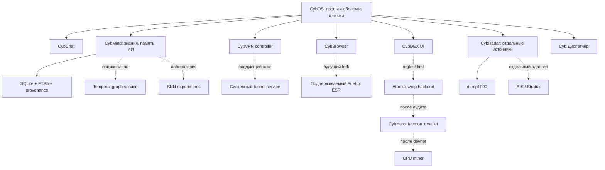

# CybOS: архитектура интеграций и проверка исходников

Дата: 11 октября 2026. Это план развития с реализованными первыми узлами, а не утверждение, что все перечисленные продукты уже встроены или прошли аудит безопасности.

## Объём проверки

Проверены все уникальные ссылки из запроса: 28 GitHub-репозиториев, Tor Browser GitLab и каталог из 20 репозиториев monero-project. Повторные ссылки rusty-task-manager и CCXT учтены один раз. Для доступных источников сохранены README, лицензии, дерево исходников, manifests и выборочные implementation files; дополнительные ключевые модули проверены для Monero, Graphiti, LangGraph, Amnezia и CCXT. Полный построчный аудит миллионов строк, сборка каждого проекта и проверка его криптографии **не выполнены**. Приватный пустой cybhero проверен авторизованным коннектором, публичный API к нему доступа не имеет. GitLab HTML был недоступен; API дал README, LICENSE и browser preferences.

## Что уже изменено в CybOS

- Локальный каталог из 66 строк/ключей для 11 языков: English, 中文, हिन्दी, Español, العربية, Français, বাংলা, Português, Русский, اردو, Bahasa Indonesia. Выбор хранится локально. Переведены навигация и общие кнопки; длинные сообщения, описания, многие внутренние формы и Swift companion остаются на исходном языке. Это **не полный перевод приложения**. Добавлены десять широко распространённых языков и отдельно сохранён русский. Список выбран по широкому охвату пользователей, без заявления единственно верного мирового рейтинга. Проверка bidi/shaping для арабского, урду, хинди и бенгальского ещё нужна.
- Отдельная вкладка CybVPN, full-tunnel WireGuard export с IPv4/IPv6 routes и DNS, сохранён отдельный private-subnet profile. Экспорт не включает туннель и не устанавливает kill switch. Сервера пока нет; приложение не показывает ложный connected status.
- CybBrowser: HTTPS-only по умолчанию, явное разрешение HTTP через переключатель, непостоянное website storage, новая сессия, запрет camera/microphone и автоматического открытия JS окон. Fingerprint resistance, Tor routing, Brave Shields и engine parity не реализованы.
- CybMind: поиск FTS5 по всей памяти, включая старые записи; trigger updates/deletes и безопасные quoted search terms. Это retrieval, а не fine-tuning нейросети. Текущий граф и локальные данные сохранены.
- ИИ: durable run lifecycle с UUID/хешем запроса и отсутствие автоматического replay после прерывания. Не полный LangGraph runtime; инструменты майнинга, переводов средств и изменения маршрутов агенту не добавлены.
- Cyb Диспетчер: собственная read-only таблица процессов, CPU/RSS, фильтр, ограниченный фоновый сбор. В sandbox ps запрещён; приложение отображает ошибку, а не фиктивные данные.
- CybRadar: реальный формат dump1090 aircraft.json, ручной импорт/opt-in loopback fetch, source timestamp, age и проверка координат. SDR hardware, Stratux и AIS ещё не подключены.
- Рыночная аналитика: отдельный CCXT public-data exporter и tests OHLCV. Existing DEX candles остаются на текущем provider. Cross-chain сделки CybHero ещё не работают: сети и ликвидности нет.
- CybHero: отдельный development scaffold, фиксированный исходник Monero, mining launch policy и документ постквантовой миграции. Mainnet, собственные consensus patches, wallet и реальный miner ещё не созданы.

## Общая архитектура

Пунктир означает будущую интеграцию. Сервисы имеют versioned контракт, request ID, deadline/cancel, size limits, health state и minimum capabilities. Процесс UI не получает wallet spend keys и права администратора. Провайдер данных не может исполнить команду через поле JSON. Нет единой кнопки «анонимно», пока маршрут, DNS и изоляция не проверены.

## Решение по каждому источнику

### 1. [monero-project/monero](https://github.com/monero-project/monero) — Кандидат основы CybHero

Сохранять согласованный протокол приватных переводов и CPU PoW, daemon/wallet RPC и консенсусные тесты. Взята точная ревизия исходника; подготовка не меняет network ID и не выпускает монету. Обязательны отдельные genesis, адресные префиксы, параметры эмиссии, seeds, тесты reorg и аудит изменений. Смешивание других криптографических протоколов исключено из первого этапа.

Лицензия: BSD-style; проверен текст LICENSE, API NOASSERTION. Архив: False. Ревизия дерева/снимка: `24272e4a3b2e812cc2a569d95b177ecef4b91e46`. Просмотренные файлы: `CMakeLists.txt`, `LICENSE`, `README.md`, `src/rpc/message.cpp`, `src/rpc/zmq_pub.cpp`, `src/rpc/rpc_args.cpp`, `src/cryptonote_config.h`, `src/ringct/bulletproofs_plus.h`, `src/wallet/wallet_rpc_server_commands_defs.h`.

### 2. [c1cad4/cybhero](https://github.com/c1cad4/cybhero) — Собственный репозиторий разработки

Через авторизованный GitHub-коннектор подтверждён доступ: приватный репозиторий был пустым. Подготовлены README, pin Monero, проект параметров сети, правила допуска CPU-майнинга и тесты. Это каркас разработки собственной сети, а не запущенная криптовалюта. Mainnet, genesis и реальные rewards ещё отсутствуют.

Лицензия: не определена. Архив: не применимо. Ревизия дерева/снимка: `пустой репозиторий`. Просмотренные файлы: GitHub metadata через авторизованный connector.

### 3. [zcash/zcash](https://github.com/zcash/zcash) — Исследование, не новый node backend

Исходный zcashd завершил поддержку и архивирован. README указывает другие реализации; для отдельного исследования shielded transactions перейти к актуальному стеку и спецификации ZIP. Нельзя добавить несколько zk-конструкций в RingCT без новой модели безопасности. Сам факт применения zero knowledge не даёт постквантовой стойкости.

Лицензия: NOASSERTION. Архив: True. Ревизия дерева/снимка: `558f686599586f55def3db86955d74d3be44605e`. Просмотренные файлы: `COPYING`, `Cargo.toml`, `README.md`, `src/httprpc.cpp`, `src/rpc/net.cpp`, `src/rpc/misc.cpp`.

### 4. [firoorg/firo](https://github.com/firoorg/firo) — Сравнение Spark и GPU PoW

Изучать дизайн приватности Spark, wallet/RPC и GPU-ориентированный FiroPOW. Это другой консенсус и другая сеть, с собственной моделью финальности. Если нужен конкурентоспособный GPU-майнинг, его выбор меняет базовый протокол CybHero; не объявлять CPU и GPU одинаково эффективными на RandomX. Компоненты не копируются в первый протокол.

Лицензия: MIT. Архив: False. Ревизия дерева/снимка: `44aff224eb4972b29d2336141f0ec1629f83db3b`. Просмотренные файлы: `CMakeLists.txt`, `COPYING`, `README.md`, `src/httprpc.cpp`, `src/rpc/net.cpp`, `src/rpc/misc.cpp`.

### 5. [AleoNet/snarkOS-test](https://github.com/AleoNet/snarkOS-test) — Исследовательский пример ZK applications

Набор типов узлов, p2p peer state и local devnet полезен как пример дисциплины запуска сети. В README ссылки ведут к ProvableHQ/snarkOS, поэтому test-repository не выбирается эталоном актуального production stack. Требования Aleo существенно тяжелее обычного desktop-приложения. ZK-приложения не заменяют Monero privacy layer и не означают защиту от квантовых атак.

Лицензия: Apache-2.0. Архив: False. Ревизия дерева/снимка: `4b156672d2f2638d0a9d69d13bcfdcd7aa39d789`. Просмотренные файлы: `Cargo.toml`, `LICENSE.md`, `README.md`, `node/network/build.rs`, `node/network/src/lib.rs`, `node/network/src/peer.rs`.

### 6. [mullvad/mullvad-browser](https://github.com/mullvad/mullvad-browser) — Основной кандидат браузерного профиля приватности

Ветка main содержит только README; настоящий исходник в release branches/tags и Tor GitLab. Сохранять нормализацию fingerprint, стандартные размеры окна, изоляцию сайтов и минимум расширений. Для полноценного CybBrowser нужен поддерживаемый fork Firefox ESR/Base Browser с регулярными security updates. Текущий WKWebView не наследует эту защиту.

Лицензия: MPL-2.0 по README; root main только README. Архив: False. Ревизия дерева/снимка: `301693c7642fd77b649c01d07e56bc22ec84c961`. Просмотренные файлы: `README.md`.

### 7. [brave/brave-browser](https://github.com/brave/brave-browser) — Референс blocker UX и Chromium-архитектуры

Репозиторий теперь содержит issues/releases/wiki, а исходный код указан в brave/brave-core. Изучать реальный core и отдельный blocker с его лицензией. Не смешивать Chromium engine с Firefox ESR. Принцип: понятное управление защитой сайтов, отдельные исключения, минимум расширений; это направление, а не внедрённый Brave Shields.

Лицензия: MPL-2.0. Архив: False. Ревизия дерева/снимка: `641b5cca1665d60e30a53233613abcd9dc55630c`. Просмотренные файлы: `LICENSE`, `README.md`, `package.json`.

### 8. [Egonex-AI/Understand-Anything](https://github.com/Egonex-AI/Understand-Anything) — Структурный граф кода и документов

GraphBuilder и merge-скрипты показывают разделение структурных и предметных связей, обновление графа частями и контроль качества merge. Для CybMind нужны stable IDs, import provenance и различие file/entity/claim/episode. Полезно для пользовательских проектов и документов; это не модель, обучающая нейросеть на всех сообщениях.

Лицензия: MIT. Архив: False. Ревизия дерева/снимка: `000fbf3f36b5e534a0a8d3461cf24f5dc9ae43fe`. Просмотренные файлы: `LICENSE`, `README.md`, `package.json`, `understand-anything-plugin/skills/understand/merge-batch-graphs.py`, `understand-anything-plugin/packages/core/src/analyzer/graph-builder.ts`, `understand-anything-plugin/skills/understand/merge-subdomain-graphs.py`.

### 9. [getzep/graphiti](https://github.com/getzep/graphiti) — Эпизодическая и временная память

Из типов nodes/edges и API add_episode взять разделение наблюдения, сущности и отношения, reference time, valid_at/invalid_at, связи с источниками. Будущий sidecar с локальной моделью и opt-in импортом должен проверять schema и лимиты. Сейчас усилен поиск SQLite FTS5; Graphiti ещё не подключён и временное разрешение противоречий не реализовано.

Лицензия: Apache-2.0. Архив: False. Ревизия дерева/снимка: `964bb11d1e7020e3cc67fab244268b0736b6c219`. Просмотренные файлы: `LICENSE`, `README.md`, `pyproject.toml`, `graphiti_core/edges.py`, `graphiti_core/nodes.py`, `graphiti_core/errors.py`, `graphiti_core/graphiti.py`.

### 10. [FalkorDB/FalkorDB](https://github.com/FalkorDB/FalkorDB) — Опциональный масштабируемый graph backend

Лицензия SSPL требует отдельной оценки условий выбранного способа распространения и сервиса. Нужны процесс/сервис, миграция графа, резервное копирование, budget памяти и драйвер. Не делать его обязательным для одного Mac: SQLite остаётся базовым хранилищем. Это серверная графовая инфраструктура, а не готовый ИИ-мозг.

Лицензия: SSPL; проверен текст LICENSE. Архив: False. Ревизия дерева/снимка: `b033aecc6e391b6730fe839f7b576f774f840b3a`. Просмотренные файлы: `Cargo.toml`, `LICENSE`, `README.md`, `graph/build.rs`, `graph/src/lib.rs`, `src/graph_core.rs`.

### 11. [basicswap/basicswap](https://github.com/basicswap/basicswap) — Первый кандидат cross-chain swap backend

Изучать коммуникацию участников, state machine, timeouts/refunds и официальные coin wallet interfaces. Для CYBH нужен собственный адаптер daemon/wallet, проверка адресов/генезиса и сценарии отмены. Смена имени XMR не создаёт поддержку CybHero. Сначала отдельный regtest/devnet backend и тесты swap/refund; потом понятный UI сделки.

Лицензия: MIT. Архив: False. Ревизия дерева/снимка: `277b46b0278f1cc76199f7e847988647a1b36e38`. Просмотренные файлы: `LICENSE`, `README.md`, `pyproject.toml`, `basicswap/rpc.py`, `basicswap/rpc_xmr.py`, `basicswap/rpc_pool.py`.

### 12. [serai-dex/serai](https://github.com/serai-dex/serai) — Альтернативный архитектурный путь, не часть BasicSwap

Сеть координации, processor и threshold signing задают другую модель доверия и эксплуатации. В репозитории смешанные MIT/AGPL лицензии; processor имеет AGPL-3.0-only. Не объединять custody assumptions с atomic swap UX под названием полностью бездоверительного DEX. Для первой версии выбирается исследование BasicSwap; Serai — отдельный сравнительный прототип.

Лицензия: MIT/AGPL по crate; processor AGPL-3.0-only. Архив: False. Ревизия дерева/снимка: `4b89cf0206184886e96d0663861596312e5b47d2`. Просмотренные файлы: `Cargo.toml`, `LICENSE`, `README.md`, `processor/src/db.rs`, `processor/src/lib.rs`, `processor/src/main.rs`, `processor/Cargo.toml`.

### 13. [langchain-ai/langgraph](https://github.com/langchain-ai/langgraph) — Checkpointed workflows для агентов

Рассмотрены типы задач, interrupt и интерфейсы checkpoint. В CybOS добавлен оригинальный журнал queued/running/completed/error/timeout с отдельными UUID и хешем запроса. Он не является полным LangGraph runtime и не возобновляет шаги автоматически. Следом: шаговые checkpoints, approval gates, cancel tokens, idempotency и структурированный результат вместо проверки строк.

Лицензия: MIT. Архив: False. Ревизия дерева/снимка: `b4991f1ba36a2449ab59c38ab71828ee865bff84`. Просмотренные файлы: `LICENSE`, `README.md`, `libs/cli/langgraph_cli/cli.py`, `libs/cli/langgraph_cli/exec.py`, `libs/cli/langgraph_cli/util.py`, `libs/langgraph/langgraph/types.py`, `libs/checkpoint/langgraph/checkpoint/base/__init__.py`.

### 14. [crewAIInc/crewAI](https://github.com/crewAIInc/crewAI) — Роли и маршрутизация задач

Рассмотрены Process, agent/core и LiteAgent: разделять цель, роль, инструменты и результат. Исследователь, хранитель знаний и разработчик должны иметь разные capabilities, budgets и проверки. Не запускать несколько одинаковых моделей для декоративной многопоточности. Сейчас один локальный помощник; полноценная orchestration ролей остаётся следующим этапом.

Лицензия: MIT. Архив: False. Ревизия дерева/снимка: `6b93fa0e25a926215ca7bb52a95d4db7d9d7262d`. Просмотренные файлы: `LICENSE`, `README.md`, `pyproject.toml`, `lib/crewai/src/crewai/process.py`, `lib/crewai/src/crewai/agent/core.py`, `lib/crewai/src/crewai/lite_agent.py`.

### 15. [flightaware/dump1090](https://github.com/flightaware/dump1090) — Первый рабочий radio-feed adapter

Официальный README-json задаёт aircraft.json, now, hex, seen и seen_pos. В CybRadar реализован opt-in loopback запрос и ручной импорт этого формата с ограничениями размера, времени и координат. Нет приёмника — нет данных. Не смешивать авиаборт с CybOS peer, не придумывать координаты и не показывать старую позицию как текущую. Live SDR не проверялся.

Лицензия: NOASSERTION. Архив: False. Ревизия дерева/снимка: `0339a57b89cd6e61856cbb13ae342c31ae7be5ac`. Просмотренные файлы: `COPYING`, `LICENSE`, `README-json.md`, `README.adaptive-gain.md`, `README.md`, `cpr.c`, `cpu.c`, `crc.c`.

### 16. [cyoung/stratux](https://github.com/cyoung/stratux) — Будущий авиационный приёмник/агрегатор

Рассмотрены network/GPS/SDR модули и устройство агрегирования источников. Нужен отдельный адаптер его актуального traffic API и проверка формата/версии, обычно отдельное оборудование. Данные о транспондерах не идентифицируют пользователей приложения. Экспериментальный consumer radar не должен представляться сертифицированным средством навигации.

Лицензия: BSD-3-Clause. Архив: False. Ревизия дерева/снимка: `36b504555408fb90dd5cf1171d4f91f99571e50c`. Просмотренные файлы: `LICENSE`, `README.md`, `main/network.go`, `main/gps.go`, `main/sdr.go`.

### 17. [jvde-github/AIS-catcher](https://github.com/jvde-github/AIS-catcher) — Будущий морской источник

Рассмотрены Network/N2K streamers и отображение графиков. Подключать отдельным GPL-сервисом либо соответствующим образом лицензированным компонентом с нормализованным контрактом vessel_id/MMSI/source_time/position. Требуются AIS receiver и тесты реальных сообщений. Морские объекты отдельным слоем, не людьми CybChat; объединение источников по UUID или имени запрещено.

Лицензия: GPL-3.0. Архив: False. Ревизия дерева/снимка: `5e43891c13f1694c9b484fa617b8e62daa9c3571`. Просмотренные файлы: `CMakeLists.txt`, `LICENSE`, `README.md`, `Source/IO/Network.cpp`, `Source/IO/N2KStream.cpp`, `frontend/src/tabs/plots/graphs.js`.

### 18. [nest/nest-simulator](https://github.com/nest/nest-simulator) — Лабораторный backend, не основная память

Это симулятор нейронных сетей и биологической динамики. Полезен для экспериментов с plasticity, а не для хранения фактов пользователя или ответа LLM. GPL-2.0-or-later; подключение как отдельный экспериментальный процесс с CPU/RAM/временем ограниченными пользователем. Не называть запуск симуляции обучение разговорного ИИ.

Лицензия: GPL-2.0. Архив: False. Ревизия дерева/снимка: `a3550804010cc3020932a8c6430dd583317c3b91`. Просмотренные файлы: `CMakeLists.txt`, `LICENSE`, `README.md`, `pyproject.toml`, `pynest/examples/pong/networks.py`, `doc/htmldoc/networks/scripts/layers.py`, `nestkernel/recording_backend_memory.cpp`.

### 19. [brian-team/brian2](https://github.com/brian-team/brian2) — Исследование SNN и обучения

Лицензия CeCILL 2.1, а не MIT; актуальный pyproject требует Python 3.12+. Рассмотрен Network runtime и memory package. Хорош для небольших воспроизводимых экспериментов со spike-time моделями. Держать в лабораторной среде, не заменять retrieval и проверяемые источники на нейронную симуляцию.

Лицензия: CeCILL-2.1; проверен текст LICENSE. Архив: False. Ревизия дерева/снимка: `240e2f0210e14a89ae2daea3c45fc875c3ac319f`. Просмотренные файлы: `LICENSE`, `README.md`, `pyproject.toml`, `brian2/core/network.py`, `brian2/memory/__init__.py`, `dev/benchmarks/processify.py`.

### 20. [BindsNET/bindsnet](https://github.com/BindsNET/bindsnet) — Опциональная SNN лаборатория на PyTorch

Nodes и Network работают с tensor state и SNN, CPU/GPU. Лицензия AGPL-3.0-only; зависимости и GPU support отдельно от MLX на Mac. Можно экспериментировать с plasticity и рекомендациями, но без утверждения, что это улучшит LLM без benchmark. Не запускать тяжёлые эксперименты фоном по умолчанию.

Лицензия: AGPL-3.0. Архив: False. Ревизия дерева/снимка: `9bd84b4759c9ddb2e8ba83c6fb0410bb1a1373a6`. Просмотренные файлы: `LICENSE`, `README.md`, `pyproject.toml`, `bindsnet/network/nodes.py`, `bindsnet/network/network.py`, `bindsnet/network/__init__.py`.

### 21. [kuzudb/kuzu](https://github.com/kuzudb/kuzu) — Не выбирать новым обязательным storage

Репозиторий архивирован; README описывает остановку проекта и варианты extensions. Уже существующие deployments могут использовать зафиксированный релиз с планом миграции, но для нового CybMind зависимость не выбирается. Идея embedded graph store полезна; текущая SQLite база и резервные копии сохраняются.

Лицензия: MIT. Архив: True. Ревизия дерева/снимка: `89f0263cc7a1fd9c396d2c4953747a013556a7f9`. Просмотренные файлы: `CMakeLists.txt`, `LICENSE`, `README.md`, `src/graph/graph.cpp`, `src/graph/graph_entry.cpp`, `src/graph/on_disk_graph.cpp`.

### 22. [vasturiano/3d-force-graph](https://github.com/vasturiano/3d-force-graph) — Опциональная 3D визуализация

MIT, WebGL/Three.js-based слой представления узлов и links. Добавлять как режим исследования больших графов в изолированном webview, с фильтрами, limits и 2D fallback. Не подключать секретные значения к внешним CDN и не считать красивый 3D граф доказательством качества памяти.

Лицензия: MIT. Архив: False. Ревизия дерева/снимка: `5ccd00f47d72a571319da70ccac080bb8e09709f`. Просмотренные файлы: `LICENSE`, `README.md`, `package.json`, `src/3d-force-graph.js`, `src/index.js`, `src/index.d.ts`.

### 23. [cytoscape/cytoscape.js](https://github.com/cytoscape/cytoscape.js) — Предпочтительный web-view 2D графа

MIT; управляемые layouts, фильтры, node/edge selection и domain navigation. Основной UX должен оставаться понятным: карточка источника, время, тип связи, почему она существует. До смены native canvas сделать общий сериализуемый schema и экспорт; текущий egui граф не заменён этим JS runtime.

Лицензия: MIT. Архив: False. Ревизия дерева/снимка: `7ba634095d8954089ee5dc09ada0030f2dca134c`. Просмотренные файлы: `LICENSE`, `README.md`, `license-update.mjs`, `package.json`, `debug/webgl/networks.js`, `benchmark/graphs/random.js`, `documentation/demos/colajs-graph/code.js`.

### 24. [gorse-io/gorse](https://github.com/gorse-io/gorse) — Отдельный рекомендательный сервис

Apache-2.0, Go, master/worker и feedback-based recommendation. Использовать только явные preferences/feedback для CybLex и знаний, локально либо opt-in сервер. Это recommendation engine, не модель общих рассуждений. Перед подключением проверить cold start, приватность истории и offline benchmark.

Лицензия: Apache-2.0. Архив: False. Ревизия дерева/снимка: `3d664dff4bc2af4b796da63b4d69d6d83b1406dc`. Просмотренные файлы: `LICENSE`, `README.md`, `go.mod`, `master/rpc.go`, `protocol/protocol_grpc.pb.go`, `protocol/data_store_grpc.pb.go`.

### 25. [amnezia-vpn/amnezia-client](https://github.com/amnezia-vpn/amnezia-client) — Основной кандидат CybVPN backend

Рассмотрены WireGuard protocol, DNS controller и lifecycle IPC process. Кандидат: AmneziaWG с собственным UI, отдельный системный service/helper, firewall/kill switch и проверка DNS/IPv6. GPL-3.0 — учитывать лицензии при распространении производного клиента. Сейчас работает подготовка WireGuard профилей; AmneziaWG runtime пока не встроен.

Лицензия: GPL-3.0. Архив: False. Ревизия дерева/снимка: `4c2e950864fc53e7567c5a8c0b4f6ac225e2ba30`. Просмотренные файлы: `CMakeLists.txt`, `LICENSE`, `README.md`, `README_RU.md`, `ipc/ipcserverprocess.cpp`, `client/mozilla/networkwatcher.cpp`, `recipes/openvpnadapter/conanfile.py`, `client/core/protocols/wireGuardProtocol.cpp`, `client/core/controllers/allowedDnsController.cpp`.

### 26. [Gozargah/Nabzram](https://github.com/Gozargah/Nabzram) — Дополнительный transport adapter

Client Marzban/Xray с process manager и собственной GPLv3 attribution notice. Полезны lifecycle процесса, health/log redaction и управление конфигурацией. SOCKS/proxy и full-device VPN — разные режимы: нужен корректный TUN/routing слой и защита от утечек. Не обещать полный VPN на основании запуска Xray-процесса.

Лицензия: GPLv3 + attribution notice; проверен текст LICENSE. Архив: False. Ревизия дерева/снимка: `d29933d556267aecfadcf0f439bc47cfb40f8c4e`. Просмотренные файлы: `LICENSE`, `README.md`, `pyproject.toml`, `app/services/process_service.py`, `ui/components/LogStreamModal.tsx`, `dev.py`.

### 27. [bazizi/rusty-task-manager](https://github.com/bazizi/rusty-task-manager) — Референс UX, оригинальная реализация

В корне не найден LICENSE; код не копируется. Старый eframe API и README TODO по CPU/RAM также исключают прямое встраивание. Cyb Диспетчер получил собственный read-only ps adapter, ограниченный фоновой сборкой и фильтром. Sandbox запрещает ps, поэтому native OS process test отмечен ignored; фактический UI необходимо проверять вне песочницы.

Лицензия: не определена. Архив: False. Ревизия дерева/снимка: `fe7592ffae8ae3c51e57b1cb468ddbb761db8e82`. Просмотренные файлы: `Cargo.toml`, `README.md`, `src/main.rs`.

### 28. [ccxt/ccxt](https://github.com/ccxt/ccxt) — Read-only market data adapter

MIT; public OHLCV через exchange adapters, rate limiting и нормализация market identity. Добавлен отдельный Python tools/read_only_markets.py с optional pin 4.5.85, allowlist бирж и строгой проверкой свечей. Кошельки и orders не подключаются. CCXT не листит CybHero автоматически и не заменяет on-chain ликвидность. Live exchange API и импорт его данных в график ещё не проверены.

Лицензия: MIT. Архив: False. Ревизия дерева/снимка: `f0aca06eb7482f083bed8406fadfcc0c05e45b1c`. Просмотренные файлы: `LICENSE.txt`, `README.md`, `package.json`, `pyproject.toml`, `go/v4/exchange.go`, `dist/ccxt.browser.js`, `go/v4/exchange_io.go`, `ts/src/base/Exchange.ts`.

### 29. [Tor Browser](https://gitlab.torproject.org/tpo/applications/tor-browser)

Получен источник через GitLab API project 472: README, LICENSE, firefox.js и 000-tor-browser.js, ветка tor-browser-153.5.0esr-16.0-1. Это Firefox-based browser, а не библиотека для WKWebView. Network proxy policy, DNS/proxy bypass prevention, local-network restrictions и целостный fingerprint profile нужно сохранять вместе с upstream security patches. Для режима Tor нужен настоящий Tor process и fail-closed routing без direct fallback. Отдельно проверить подресурсы, WebRTC, downloads и обновления. Копирование отдельных preferences не переносит защиту движка.

### 30. [Каталог monero-project](https://github.com/orgs/monero-project/repositories)

Получены metadata всех 20 репозиториев организации. Их перечисление ниже — inventory; исходник каждого вспомогательного проекта не проходил отдельный аудит. Monero core выбирается основой, GUI/doc/research/build infrastructure — возможные отдельные инструменты. Исторические и архивные реализации не подключать автоматически.

- [monero](https://github.com/monero-project/monero): Monero: the secure, private, untraceable cryptocurrency; archived=False.
- [xmr-seeder](https://github.com/monero-project/xmr-seeder): описание не задано; archived=False.
- [mininero](https://github.com/monero-project/mininero): A Python reimplementation of the one-time ring signatures as found in Monero; archived=False.
- [monero-forum](https://github.com/monero-project/monero-forum): The Monero Forum Software; archived=True.
- [monero-site](https://github.com/monero-project/monero-site): описание не задано; archived=False.
- [monero-gui](https://github.com/monero-project/monero-gui): Monero: the secure, private, untraceable cryptocurrency; archived=False.
- [research-lab](https://github.com/monero-project/research-lab): A general repo for Monero Research Lab work in progress and completed work; archived=False.
- [kovri](https://github.com/monero-project/kovri): The Kovri I2P Router Project; archived=True.
- [meta](https://github.com/monero-project/meta): A Meta Repository for General Monero Project Matters; archived=False.
- [kovri-docs](https://github.com/monero-project/kovri-docs): описание не задано; archived=False.
- [kovri-site](https://github.com/monero-project/kovri-site): описание не задано; archived=False.
- [unbound](https://github.com/monero-project/unbound): Local mirror of unbound for use in the Monero Project; archived=True.
- [supercop](https://github.com/monero-project/supercop): описание не задано; archived=False.
- [miniupnp](https://github.com/monero-project/miniupnp): описание не задано; archived=True.
- [kastelo](https://github.com/monero-project/kastelo): The Sekura Monero Hardware Wallet; archived=False.
- [gitian.sigs](https://github.com/monero-project/gitian.sigs): описание не задано; archived=False.
- [monero-docs](https://github.com/monero-project/monero-docs): Hosted at docs.getmonero.org; archived=False.
- [guix](https://github.com/monero-project/guix): описание не задано; archived=False.
- [guix.sigs](https://github.com/monero-project/guix.sigs): описание не задано; archived=False.
- [monero-bounties](https://github.com/monero-project/monero-bounties): Monero bounty fider bot; archived=False.

## CybVPN и браузер: условия настоящей защиты

Сначала собственный VPS или управляемый gateway, server forwarding/NAT, authentication и ключи. VPN encrypts device-to-server traffic, но сервер и сетевые endpoints остаются в модели доверия. Локальный private-subnet tunnel не защищает обычный интернет. Для полноценного controller нужны macOS Network Extension/подписанный helper, Windows service и отдельный Linux privilege boundary, а также revocation и reproducible updates.

Проверки: смена Wi-Fi, reconnect, потеря сервера, сон, crash UI/helper, restart, DNS запросы, IPv6, split routes и fail-closed firewall. Подтверждать connected только по live tunnel/route checks; handshake отдельно не доказывает отсутствие утечек. Не менять системные маршруты в этом прототипе.

Для браузера выбирается один engine. Firefox ESR/Mullvad-based вариант предпочтителен для стандартного fingerprint profile; Brave-based Chromium — другой проект с иной стратегией. WebKit helper остаётся удобным базовым просмотром. Разделять «частная сессия», «VPN» и «Tor». Разрешения и исключения сайтов должны быть понятными и храниться по origin. Нет гарантии изоляции от ОС-хозяина или полного отсутствия следов.

## CybMind: ИИ, граф и память

Предлагаемый rebranding: CybMind = assistant + private memory + knowledge graph. Эпизод содержит source_id, content hash, captured_at, event/reference time, type, consent scope. Claim отдельно содержит subject/relation/object, confidence, source references и valid interval. Пользовательское утверждение, найденная веб-страница и проверенный факт — разные типы доказательств.

Import pipeline: validated input → extraction candidate → entity resolution → schema checks → provenance → atomic commit → index → retrieval with source references. Не удалять старое утверждение при противоречии без журнала. Не принимать команды из извлечённого текста; embeddings и граф не являются доверенным системным prompt. Global sync по явному scope, с export preview и удалением; глобальная сеть не получает все сообщения по умолчанию.

Первым сохраняется SQLite/FTS5, далее optional Graphiti sidecar. Большая БД/FalkorDB нужна только по измеренной потребности. Kuzu не выбирать основой нового проекта. Cytoscape — понятный 2D просмотр, 3d-force-graph — дополнительное исследование. Gorse — рекомендации, NEST/Brian/BindsNET — лаборатория. Ни один из них сам по себе не обучает Qwen на личных данных.

Агентный pipeline: plan → allowed tool → bounded observation → validate → checkpoint → answer with evidence. Роли разделяются capabilities, не только разными названиями. Следующие проверки: cancellation, database failures, interrupted runs, duplicate tool requests, malicious retrieved instructions, memory source mismatch и offline inference. Автоматические финансовые операции и запуск майнинга остаются вне инструментов агента.

## CybDEX и аналитика

Сейчас live market view и технические индикаторы отделены от исполнения сделки. Сохранять network/chain ID, token contract/mint, pool ID, base/quote, decimals, timestamp/source и тип рынка. Название монеты не идентификатор; отсутствие пары нельзя заменить синтетическим графиком.

CCXT используется для public exchange quotes/OHLCV с rate limits и nullable fields. Marketcap, on-chain liquidity, holder concentration и contract risk требуют других явных источников. Цена и технические индикаторы не прогноз доходности. Python exporter — отдельный инструмент; импорт в UI и live provider проверяются следующим этапом.

Первый cross-chain путь: отдельный BasicSwap-based эксперимент с CybHero adapter на devnet. State machine: offer → acceptance → locks/proofs → redeem либо timeout/refund → confirmations. Тестировать обе роли, partial failure, fees, reorg, неправильную сеть и восстановление wallet. Serai threshold/network путь исследовать отдельно. До работающей CYBH сети, кошелька и ликвидности не показывать выдуманные торгуемые пары CYBH.

## Последовательность разработки и критерии готовности

1. Завершить локализацию всех экранов/ошибок/Swift helpers, проверить одиннадцать языков и четыре сложных письма в UI. Сейчас 66 keys, без заявления полного перевода.
2. CybVPN: поднять сервер и подписанный системный controller; только после route/DNS/IPv6/crash tests выпускать кнопку подключения.
3. CybBrowser: выбрать upstream engine и поддерживаемые release pins, построить fork, выполнить browser security/fingerprint/leak checks. Не обещать parity текущему WebKit.
4. CybMind: temporal provenance/schema, импорт документов, source-grounded retrieval, отдельный graph visualizer и сравнение качества на наборе задач.
5. Агенты: структурированные результаты, checkpoints шагов, cancel/approval/idempotency, затем specialist roles с минимальными permissions.
6. CybHero: сеть/эмиссия/уникальный genesis, consensus patch, multi-node devnet, wallet, CPU miner, maturity/reorg tests, криптографический аудит; после этого mainnet. Подробнее — MINING_AND_POST_QUANTUM_RU.md.
7. DEX: read-only data import, devnet atomic swaps и recovery/refunds, затем production adapter после аудита и наличия ликвидности.
8. Radar: реальный ADS-B receiver test, отдельные Stratux/AIS adapters и метки свежести; hardware отсутствует, therefore live validation pending.
9. Dispatcher: native process enumeration на поддерживаемых ОС, дополнительно CPU/RAM отдельных helpers и hardware sensors только при доступных измерениях.

Сроки не назначены: объём зависит от серверов, оборудования, выбранного консенсуса и независимых проверок. Все шаги остаются частью разработки; этот первый набор изменений не объявляется готовой анонимной ОС или защищённым mainnet.
